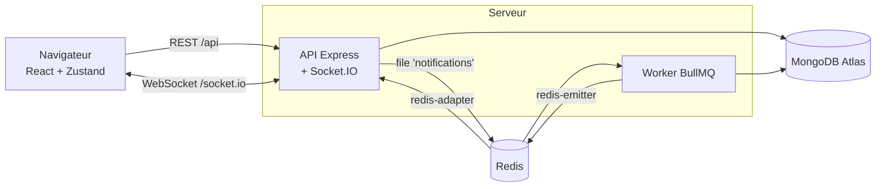

# Nexora

Réseau social temps réel : fil d'actualité, commentaires, chat privé et notifications en direct.

> État : **MVP** (étape 2 de la roadmap). Voir [Feuille de route](#feuille-de-route) pour ce qui reste.

## Architecture



- **Sans Redis** (`REDIS_URL` vide) : les notifications sont créées directement par l'API, Socket.IO tourne sur une seule instance.
- **Avec Redis** : l'API pousse dans la file BullMQ, le worker traite et diffuse via l'adapter Redis (permet plusieurs réplicas API).
- **Sans `MONGO_URI`** en développement : MongoDB en mémoire, données perdues à l'arrêt.

## Démarrage rapide (Windows / PowerShell)

Prérequis : Node.js ≥ 20.

```powershell
cd server; copy .env.example .env; npm install; npm run dev
```

Dans un second terminal :

```powershell
cd client; npm install; npm run dev
```

Ouvrir http://localhost:5173, créer un compte. Le premier lancement télécharge le binaire MongoDB (~600 Mo) si `MONGO_URI` est vide.

- Si le port 5173 est déjà pris (ex. un autre projet Vite) : `npm run dev -- --port 5180 --host 127.0.0.1`.
- Sur un PC avec peu de RAM libre, la vérification MD5 du binaire MongoDB peut échouer (`ERR_MEMORY_ALLOCATION_FAILED`) : vérifier l'archive à la main (`certutil -hashfile <zip> MD5` comparé au `.md5` dans `%USERPROFILE%\.cache\mongodb-binaries`), puis lancer avec `$env:MONGOMS_MD5_CHECK=0`. Avec Atlas, ce binaire n'est plus nécessaire.

### Brancher les services cloud

1. **MongoDB Atlas** (offre M0 gratuite) : créer un cluster, un utilisateur de base, autoriser votre IP, copier l'URI `mongodb+srv://…` dans `MONGO_URI`.
2. **Redis** (Upstash ou Redis Cloud, offre gratuite) : copier l'URL `rediss://…` dans `REDIS_URL`, puis lancer le worker : `npm run worker`.
3. Générer un secret JWT et le mettre dans `JWT_ACCESS_SECRET` :
   ```powershell
   node -e "console.log(require('crypto').randomBytes(48).toString('hex'))"
   ```

### Devenir admin

Le rôle se change en base (collection `users`, champ `role: "admin"`), puis via `PATCH /api/admin/users/:id/role`.

## API

| Méthode | Route | Description |
|---|---|---|
| POST | `/api/auth/register` | Inscription (consentement CGU obligatoire) |
| POST | `/api/auth/login` | Connexion → access token + cookie refresh |
| POST | `/api/auth/refresh` | Rotation du refresh token (détection de réutilisation) |
| POST | `/api/auth/logout` | Révocation de la session |
| GET | `/api/auth/me` | Profil courant |
| GET/POST | `/api/posts` | Fil paginé (`?cursor=&limit=`) / publier |
| DELETE | `/api/posts/:id` | Auteur, modérateur ou admin |
| POST | `/api/posts/:id/like` | Like / unlike |
| GET/POST | `/api/posts/:id/comments` | Commentaires |
| GET | `/api/messages` · `/api/messages/:userId` | Conversations / historique |
| GET | `/api/notifications` · POST `/read-all` | Notifications |
| GET | `/api/users/search?q=` · `/api/users/:id` | Recherche / profil |
| GET | `/api/me/export` | RGPD : export JSON |
| PATCH | `/api/me/consents` | RGPD : consentement marketing |
| DELETE | `/api/me` | RGPD : suppression du compte |
| GET | `/api/admin/stats` · `/api/admin/audit` | Admin (RBAC) |
| GET | `/healthz` · `/readyz` | Sondes Kubernetes |

Événements Socket.IO : `chat:send` (avec ack), `chat:message`, `chat:typing`, `notification`, `post:new`, `post:likes`, `post:comments`, `post:deleted`, `post:join`/`post:leave`, `comment:new`.

## Sécurité

- Access token JWT 15 min gardé en mémoire côté client (jamais en localStorage).
- Refresh token opaque, haché (SHA-256) en base, cookie `httpOnly` `SameSite=Strict` limité à `/api/auth`, rotation à chaque usage ; réutilisation d'un ancien token ⇒ révocation de toute la famille + entrée d'audit.
- bcrypt (coût 12), rate limiting sur l'auth, Helmet, validation Zod, CORS restreint.
- CI : tests, `npm audit`, Trivy, CodeQL, Dependabot.

## Feuille de route

| Étape | Statut |
|---|---|
| 1. Dépôt Git | ✅ |
| 2. Génération du code (MVP) | ✅ auth, feed, commentaires, chat, notifications, RGPD, admin de base |
| 3. Environnement staging | ⏳ manifests Kubernetes (API, worker, HPA, Ingress, NetworkPolicies, External Secrets) |
| 4. Développement fonctionnel | ⏳ upload Multer + Cloudinary, modération IA, WebRTC, i18n, Recharts, observabilité (Prometheus, Grafana, OpenTelemetry, Jaeger), k6, Cosign + SLSA |
| 5. Production | ⏳ |

## Journal des décisions

| Date | Décision | Raison |
|---|---|---|
| 2026-11-27 | Monorepo `server/` + `client/` (JS ESM, sans TypeScript) | Démarrage rapide ; migration TS possible plus tard |
| 2026-11-27 | MongoDB Atlas + Redis cloud, avec repli mémoire en dev | Docker non installé sur le poste de dev |
| 2026-11-27 | Redis optionnel (file + adapter activés seulement si `REDIS_URL`) | Pouvoir développer sans aucun service externe |
| 2026-11-27 | Vite proxifie `/api` et `/socket.io` | Même origine ⇒ cookie refresh `SameSite=Strict` fonctionnel |
| 2026-11-27 | Pagination par curseur `_id` | Infinite scroll stable même si de nouveaux posts arrivent |
