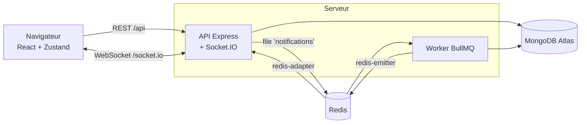
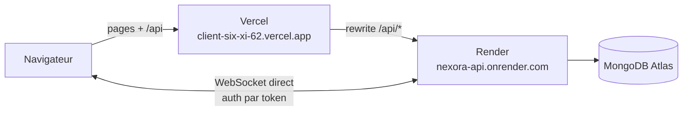

# Nexora

Réseau social temps réel : fil d'actualité, commentaires, chat privé et notifications en direct.

> État : **étape 4** (fonctionnalités) en cours. Démo en ligne : site sur Vercel, API sur Render, base MongoDB Atlas — voir [Mise en ligne](#mise-en-ligne-vercel--render--atlas).

## Architecture



- **Sans Redis** (`REDIS_URL` vide) : les notifications sont créées directement par l'API, Socket.IO tourne sur une seule instance.
- **Avec Redis** : l'API pousse dans la file BullMQ, le worker traite et diffuse via l'adapter Redis (permet plusieurs réplicas API).
- **Sans `MONGO_URI`** en développement : MongoDB en mémoire, données perdues à l'arrêt.

## Démarrage rapide (Windows / PowerShell)

Prérequis : Node.js ≥ 20.

```powershell
cd server; copy .env.example .env; npm install; npm run dev
```

Dans un second terminal :

```powershell
cd client; npm install; npm run dev
```

Ouvrir http://localhost:5173, créer un compte. Le premier lancement télécharge le binaire MongoDB (~600 Mo) si `MONGO_URI` est vide.

- Si le port 5173 est déjà pris (ex. un autre projet Vite) : `npm run dev -- --port 5180 --host 127.0.0.1`.
- Sur un PC avec peu de RAM libre, la vérification MD5 du binaire MongoDB peut échouer (`ERR_MEMORY_ALLOCATION_FAILED`) : vérifier l'archive à la main (`certutil -hashfile <zip> MD5` comparé au `.md5` dans `%USERPROFILE%\.cache\mongodb-binaries`), puis lancer avec `$env:MONGOMS_MD5_CHECK=0`. Avec Atlas, ce binaire n'est plus nécessaire.

### Brancher les services cloud

1. **MongoDB Atlas** (offre M0 gratuite) : créer un cluster, un utilisateur de base, autoriser votre IP, copier l'URI `mongodb+srv://…` dans `MONGO_URI`.
2. **Redis** (Upstash ou Redis Cloud, offre gratuite) : copier l'URL `rediss://…` dans `REDIS_URL`, puis lancer le worker : `npm run worker`.
3. Générer un secret JWT et le mettre dans `JWT_ACCESS_SECRET` :
   ```powershell
   node -e "console.log(require('crypto').randomBytes(48).toString('hex'))"
   ```

### Devenir admin

Le rôle se change en base (collection `users`, champ `role: "admin"`), puis via `PATCH /api/admin/users/:id/role`.

## Mise en ligne (Vercel + Render + Atlas)



Vercel n'héberge que le site : ses fonctions ne gardent pas de WebSocket (chat, notifications, appels). L'API tourne sur Render.
Le REST passe par Vercel (même origine ⇒ cookie de session `SameSite=Strict` OK) ; les WebSocket vont directement à Render (authentifiés par l'access token, sans cookie).

1. **MongoDB Atlas** — https://cloud.mongodb.com : créer un projet, un cluster **M0** (gratuit, région Europe).
   *Database Access* → ajouter un utilisateur avec mot de passe généré. *Network Access* → `0.0.0.0/0` (Render free n'a pas d'IP fixe).
   *Connect → Drivers* → copier l'URI `mongodb+srv://…`, remplacer `<password>` et ajouter `/nexora` avant le `?`.
2. **Render** — https://dashboard.render.com : *New → Blueprint* → dépôt `Svperman/Nexora` (lit `render.yaml`).
   Coller `MONGO_URI` quand Render le demande (les autres champs `sync: false` sont optionnels). Vérifier `https://nexora-api.onrender.com/readyz` → `{"mongo":true}`.
   Si Render attribue un autre nom que `nexora-api`, remplacer l'URL dans `client/vercel.json` et `client/.env.production`.
3. **Vercel** — projet `client` : *Settings → General → Root Directory* = `client`, puis redéployer (un push sur `main` suffit).
   Le projet Vercel `server` n'est plus utilisé : le supprimer ou le déconnecter du dépôt.

Limites de l'offre gratuite Render : l'API s'endort après 15 min sans visite ; la première requête prend ~30-60 s.
Sans `CLOUDINARY_URL`, l'upload d'images renvoie 503 en production (pas de disque persistant sur Render).

## API

| Méthode | Route | Description |
|---|---|---|
| POST | `/api/auth/register` | Inscription (consentement CGU obligatoire) |
| POST | `/api/auth/login` | Connexion → access token + cookie refresh |
| POST | `/api/auth/refresh` | Rotation du refresh token (détection de réutilisation) |
| POST | `/api/auth/logout` | Révocation de la session |
| GET | `/api/auth/me` | Profil courant |
| GET/POST | `/api/posts` | Fil paginé (`?cursor=&limit=`) / publier |
| DELETE | `/api/posts/:id` | Auteur, modérateur ou admin |
| POST | `/api/posts/:id/like` | Like / unlike |
| GET/POST | `/api/posts/:id/comments` | Commentaires |
| GET | `/api/messages` · `/api/messages/:userId` | Conversations / historique |
| GET | `/api/notifications` · POST `/read-all` | Notifications |
| GET | `/api/users/search?q=` · `/api/users/:id` | Recherche / profil |
| GET | `/api/me/export` | RGPD : export JSON |
| PATCH | `/api/me/consents` | RGPD : consentement marketing |
| DELETE | `/api/me` | RGPD : suppression du compte |
| GET | `/api/admin/stats` · `/api/admin/audit` | Admin (RBAC) |
| POST | `/api/uploads` | Upload d'image (multipart `image`, 5 Mo, JPEG/PNG/WebP/GIF vérifiés par signature) |
| GET | `/api/moderation/queue` · POST `/api/moderation/:kind/:id` | File de revue (modérateur/admin), `approve` ou `remove` |
| GET | `/api/rtc/config` | Serveurs ICE (STUN + TURN) pour les appels |
| GET | `/healthz` · `/readyz` · `/metrics` | Sondes et métriques Prometheus (`/metrics` non exposé par l'Ingress) |

Événements Socket.IO : `chat:send` (avec ack), `chat:message`, `chat:typing`, `notification`, `post:new`, `post:likes`, `post:comments`, `post:deleted`, `post:join`/`post:leave`, `comment:new`, et pour les appels `call:offer`, `call:answer`, `call:ice`, `call:reject`, `call:end` (relayés seulement, l'expéditeur est imposé par le serveur).

## Sécurité

- Access token JWT 15 min gardé en mémoire côté client (jamais en localStorage).
- Refresh token opaque, haché (SHA-256) en base, cookie `httpOnly` `SameSite=Strict` limité à `/api/auth`, rotation à chaque usage ; réutilisation d'un ancien token ⇒ révocation de toute la famille + entrée d'audit.
- bcrypt (coût 12), rate limiting sur l'auth, Helmet, validation Zod, CORS restreint.
- Uploads : type réel vérifié par signature (pas le `Content-Type` client), EXIF retiré par Cloudinary, seules les images hébergées par Nexora sont acceptées dans un post.
- Modération IA (Claude, `MODERATION_ENABLED=true`) : `block` ⇒ refus 422 sans stockage du contenu (motif journalisé) ; `flag` ou API indisponible ⇒ publié mais visible seulement par l'auteur jusqu'à revue humaine.
- CI : tests, `npm audit`, Trivy, CodeQL, Dependabot. Images signées Cosign (keyless) + attestation de provenance SLSA + SBOM ; règle Kyverno optionnelle `k8s/policies/verify-images.yaml`.

## Feuille de route

| Étape | Statut |
|---|---|
| 1. Dépôt Git | ✅ |
| 2. Génération du code (MVP) | ✅ auth, feed, commentaires, chat, notifications, RGPD, admin de base |
| 3. Environnement staging | 🟡 manifests Kubernetes et images prêts ([k8s/README.md](k8s/README.md)) ; reste à choisir le cluster, le domaine et le gestionnaire de secrets |
| 4. Développement fonctionnel | 🟡 fait : upload Multer + Cloudinary, modération IA, appels WebRTC 1-à-1, i18n FR/EN, observabilité (Prometheus, Grafana, alertes, OpenTelemetry → Jaeger, `k8s/monitoring/`), test de charge k6 (`load-test/`), Cosign + SLSA. Reste : Recharts dans l'admin, appels testés seulement en signalisation (pas entre deux vrais navigateurs) |
| 5. Production | ⏳ |

## Journal des décisions

| Date | Décision | Raison |
|---|---|---|
| 2026-11-27 | Monorepo `server/` + `client/` (JS ESM, sans TypeScript) | Démarrage rapide ; migration TS possible plus tard |
| 2026-11-27 | MongoDB Atlas + Redis cloud, avec repli mémoire en dev | Docker non installé sur le poste de dev |
| 2026-11-27 | Redis optionnel (file + adapter activés seulement si `REDIS_URL`) | Pouvoir développer sans aucun service externe |
| 2026-11-27 | Vite proxifie `/api` et `/socket.io` | Même origine ⇒ cookie refresh `SameSite=Strict` fonctionnel |
| 2026-11-27 | Pagination par curseur `_id` | Infinite scroll stable même si de nouveaux posts arrivent |
| 2026-11-27 | Kustomize (base + overlay staging) plutôt que Helm | Lisible, intégré à `kubectl`, suffisant pour 2 environnements |
| 2026-11-27 | Images sur GHCR, taguées `main` et `sha-<commit>` | Gratuit avec GitHub, traçabilité commit → image |
| 2026-11-27 | Front servi par nginx derrière le même Ingress que l'API | Une seule origine ⇒ cookie refresh `SameSite=Strict` sans CORS |
| 2026-11-27 | Worker = même image que l'API | Une seule image à construire, scanner et signer |
| 2026-11-27 | External Secrets avec Doppler en exemple pour le staging | Aucun secret dans Git ; fournisseur remplaçable via le SecretStore |
| 2026-11-27 | Redis interne au cluster en option, Socket.IO en WebSocket seul | Pas besoin de sticky sessions avec plusieurs réplicas API |
| 2026-11-27 | Signature Cosign keyless + `attest-build-provenance` après scan Trivy | Aucune clé à gérer ; on ne signe que des images scannées, par digest |
| 2026-11-27 | Métriques `prom-client` + OTel chargé par `--import` seulement si `OTEL_EXPORTER_OTLP_ENDPOINT` | Zéro coût en dev/tests ; instrumentation ESM correcte |
| 2026-11-27 | Upload via l'API (Multer mémoire → Cloudinary), repli disque en dev | Contrôle du type et de la taille côté serveur ; dev sans compte Cloudinary |
| 2026-11-27 | Modération Claude synchrone, sortie structurée Zod, `fallbacks: "default"` | Verdict avant publication ; `claude-opus-5-5` par défaut, `MODERATION_MODEL=claude-haiku-5-5` ~40× moins cher |
| 2026-11-27 | Appels WebRTC pair-à-pair, signalisation Socket.IO, TURN optionnel | Pas de serveur média à héberger ; TURN nécessaire derrière certains NAT |
| 2026-11-27 | i18n maison (dictionnaires FR/EN, Zustand) plutôt que i18next | ~100 clés, zéro dépendance ; migrable si les langues se multiplient |
| 2026-11-27 | Démo : site sur Vercel, API sur Render, base Atlas | Vercel ne garde pas de WebSocket ; Render gratuit les supporte |
| 2026-11-27 | REST via rewrite Vercel, WebSocket en direct vers Render, `TRUST_PROXY=2` | Cookie refresh même origine ; vraie IP client pour le rate limiting |
