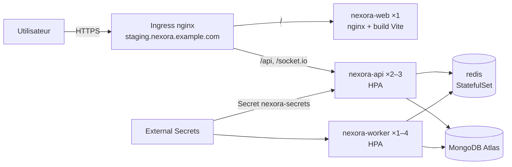

# Déploiement Kubernetes

Manifests organisés avec Kustomize : `base/` commun, `overlays/staging/` pour l'environnement de staging.



| Fichier | Rôle |
|---|---|
| `base/api.yaml` | Deployment API + Service + PodDisruptionBudget, sondes `/readyz` `/healthz` |
| `base/worker.yaml` | Worker BullMQ (même image que l'API, commande `node src/worker.js`) |
| `base/web.yaml` | Front React servi par nginx non-root (port 8080) |
| `base/redis.yaml` | Redis interne (AOF, `noeviction` pour BullMQ). Optionnel si Redis cloud |
| `base/hpa.yaml` | Autoscaling API (2→6, CPU 70 % / mémoire 80 %) et worker (1→4) |
| `base/ingress.yaml` | Une seule origine : `/` front, `/api` + `/socket.io` API, TLS cert-manager |
| `base/networkpolicies.yaml` | Tout refusé par défaut, puis DNS, ingress → api/web, api/worker → redis + Internet (Atlas) |
| `base/external-secret.yaml` | `MONGO_URI`, `REDIS_URL`, `JWT_ACCESS_SECRET` depuis le gestionnaire de secrets |
| `overlays/staging/` | Namespace `nexora-staging` (Pod Security `restricted`), domaine, SecretStore Doppler, tailles réduites |

Tous les pods tournent sans root, système de fichiers en lecture seule, capabilities supprimées, seccomp `RuntimeDefault`.

## Prérequis du cluster

N'importe quel cluster managé (OVHcloud MKS, Scaleway Kapsule, DigitalOcean, GKE…) avec :

1. **ingress-nginx** (namespace `ingress-nginx`) — les NetworkPolicies supposent ce nom.
2. **cert-manager** avec deux `ClusterIssuer` : `letsencrypt-staging` (utilisé par le staging) et `letsencrypt`.
3. **External Secrets Operator** (API `external-secrets.io/v1`).
4. **metrics-server** pour les HPA.
5. Un CNI qui applique les NetworkPolicies (Calico, Cilium — inclus sur la plupart des offres managées).

## Mise en route du staging

1. **Images** : le workflow `Images` publie `ghcr.io/svperman/nexora-api` et `nexora-web` à chaque push sur `main` (tags `main` et `sha-<commit>`). Si le dépôt est privé, rendre les packages publics dans GitHub → Packages, ou ajouter un `imagePullSecret`.
2. **Domaine** : remplacer `staging.nexora.example.com` dans `overlays/staging/kustomization.yaml` et pointer le DNS vers l'IP de l'ingress.
3. **Secrets** (dans Doppler, projet `nexora`, config `stg`) : `MONGO_URI` (Atlas), `REDIS_URL` (`redis://redis:6379` pour le Redis interne, ou l'URL Upstash), `JWT_ACCESS_SECRET` (≥ 32 caractères aléatoires).
4. **Jeton Doppler** : seul secret créé à la main, une fois :
   ```powershell
   kubectl create namespace nexora-staging
   kubectl -n nexora-staging create secret generic doppler-token --from-literal=token=<jeton-service-doppler>
   ```
5. **Atlas** : dans Network Access, autoriser l'IP de sortie (NAT) du cluster.
6. **Déployer** :
   ```powershell
   kubectl apply -k k8s/overlays/staging
   kubectl -n nexora-staging rollout status deploy/nexora-api
   ```

Pour épingler une version précise, remplacer `newTag: main` par `newTag: sha-<commit>` dans l'overlay.

## Validation locale

Sans cluster, vérifier le rendu : `kubectl kustomize k8s/overlays/staging` (ou `kustomize build`).
